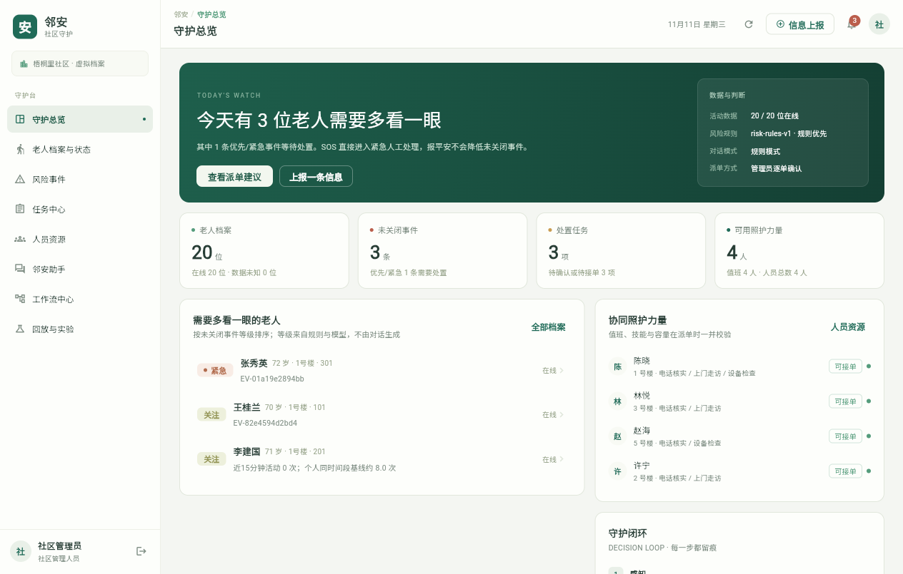
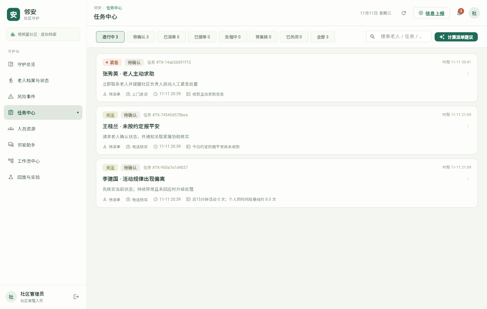
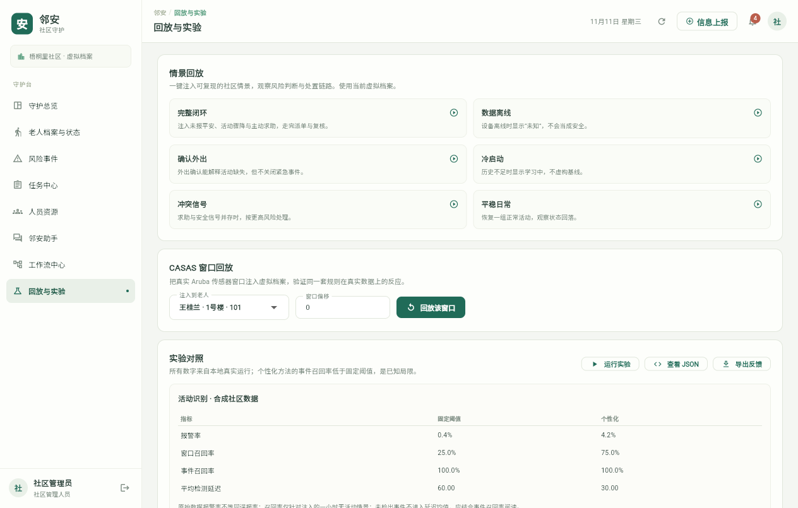
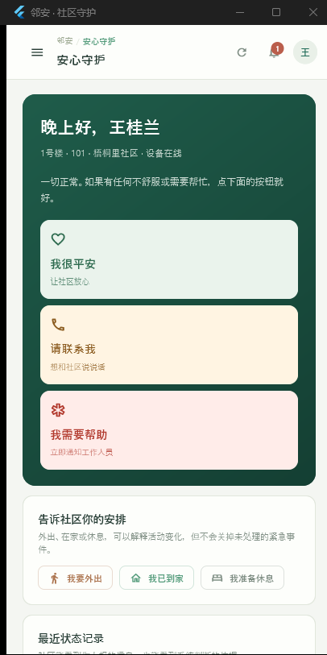

# 邻安 · LinAn

> 独居老人社区协同守护智能决策系统（比赛原型）  
> 从一条异常活动，到一次有人接住的上门核实——每个判断有依据，每个动作有留痕。


跑通 **状态上报 → 异常识别 → 风险分级 → 人员推荐 → 自动或人工确认派单 → 处置反馈 → 人工复核关闭** 的完整闭环，并在风险引擎与调度状态机之上提供四类业务 Agent、四角色对话助手、可追踪的工作流中心、带租约与死信的持久化任务队列、角色作用域上下文封装和只读 MCP 服务。

| 守护总览 | 任务中心 |
|---|---|
|  |  |

| 实验对照 | 手机端安心守护 |
|---|---|
|  |  |

## 形态

仓库根目录即完整的本地版本：后端、Flutter 客户端、脚本、测试与文档平铺展开，不再嵌套子目录。

| 组成 | 技术栈 |
|---|---|
| 后端 | FastAPI + SQLite + scikit-learn / SciPy |
| 客户端 | Flutter 3（Windows 桌面与 Android 共用 `app/lib` 一套 Dart 代码） |
| 界面 | Flutter 自绘，遵循 Apple Human Interface Guidelines 的系统风格，跟随系统浅色/深色外观 |
| 数据 | 20 位虚拟老人、4 位工作人员，合成基线 + CASAS Aruba 公开数据 |

不提供网页版，也不依赖云端服务；所有功能都在本机以 Windows 客户端或 Android 客户端连接本机 FastAPI 运行。

## 快速开始

准备：**Python 3.12+**、**Flutter 3.47+**（Windows 桌面构建还需要 Visual Studio 2022 的 C++ 桌面开发组件）。

```powershell
powershell -ExecutionPolicy Bypass -File ./Setup.ps1
powershell -ExecutionPolicy Bypass -File ./Setup.ps1 -RebuildApp -FlutterExecutable "E:/tools/flutter/bin/flutter.bat"
powershell -ExecutionPolicy Bypass -File ./Start.ps1 -OpenApp
```

`Start.ps1` 启动本机 8765 端口的 FastAPI 服务，并打开 Windows 客户端；接口文档在 <http://127.0.0.1:8765/docs>。后台启动用 `-Background`，停止用 `./Stop.ps1`。

### 开发与调试

后端与客户端分开运行，改代码后热重载：

```powershell
# 终端 1：只启动后端（不自动打开客户端）
powershell -ExecutionPolicy Bypass -File ./Start.ps1 -Background

# 终端 2：Windows 调试，支持热重载
cd app
flutter run -d windows
```

Android 调试需要模拟器或真机：`flutter run -d <device-id>`，客户端默认连 `10.0.2.2:8765`，登录页可改为电脑的局域网地址。

## 演示账号

所有账号初始密码均为 **Demo2026!**，只对应虚拟档案。

| 账号 | 角色 | 权限范围 |
|---|---|---|
| `admin` | 社区管理员 | 全部演示档案、派单、复核、实验 |
| `staff1`—`staff4` | 照护人员 | 自己的任务、当前关联服务对象、自己的人员状态 |
| `family` | 家属 | 仅王桂兰的状态、上报与消息 |
| `elder` | 老人本人 | 仅王桂兰的报平安、求助与状态 |

## 核心设计

- **规则先行**：主动求助直接进入紧急人工处理；报平安、外出确认与模型文字都不能降低或关闭未关闭的紧急事件。
- **未知不是正常**：数据缺失单独显示"状态未知"；历史不足 14 天显示"基线学习中"，不生成虚构成熟基线。
- **模型只解释**：风险等级由规则与离线模型决定，大模型只解释证据、查询授权记录并生成建议；每次读取工具与会话历史都重验角色和对象权限。
- **模型可自配置**：管理员在“设置”页填写 OpenAI 兼容接口地址、模型与 API Key；模型名称可从服务商模型目录获取后选择，也可手动填写。密钥仅保存在本机数据库且只回显尾号，保存后下一次 Agent 运行生效，停用即回到规则模式。
- **派单可复核**：按紧急程度与等待时间优先覆盖任务，再最小化本批仿真到达时间；确认时校验版本、技能、值班、可用性与单人容量。
- **一切留痕**：风险输入快照、推荐理由、人工调整、操作人与时间、Agent 运行节点均可追溯；SQLite 写入使用 `BEGIN IMMEDIATE` 与部分唯一索引。

## 验证

```powershell
powershell -ExecutionPolicy Bypass -File ./Verify.ps1 -FlutterExecutable "E:/tools/flutter/bin/flutter.bat"
```

依次执行后端 `pytest`、`flutter analyze`、`flutter test` 与 Windows Release 构建。2026-11-12 实测：后端 **77 passed**、`flutter analyze` 无问题、`flutter test` 6 passed、Windows 构建通过；管理员/照护/家属/老人四角色客户端闭环与权限边界均通过，客户端还验证了浅色/深色外观与 200% 字号。详细记录、截图与已知限制见 [验证说明](docs/VERIFICATION.md)，本轮审计与修复清单见 [审计记录](docs/AUDIT_2026-11-12.md)，实验数据见 [实验报告](docs/EXPERIMENT_REPORT.md)。

## 数据与已知局限

公开实验基于 CASAS Aruba，按完整日期顺序近似 60% / 20% / 20% 划分，基线只用训练段、森林阈值只用验证段。**个性化方法对注入异常的事件召回率为 45%，低于固定阈值的 100%，不能作为独立安全保障。** 原始报警率不等于误报率，当前为开发评估，不是盲测或真实社区效果。

社区、老人、联系人、工作人员与到达时间矩阵均为合成数据；演示密码与角色体系不能替代真实社区的账户管理和数据授权流程。本机环境未做 Android 真机安装与 iOS/macOS 构建，详见验证文档。

## 走完一次闭环

1. 管理员进入“回放与实验”，选择“三位老人，同时需要关注”；也可演示数据离线、外出、冷启动或资源冲突。
2. 风险事件或老人详情显示信息来源、个人基线、判断依据与建议措施。
3. 在任务中心“计算派单建议”，查看技能、值班状态与仿真到达时间；调整人员必须填写原因。
4. 确认时重新检查任务与人员版本、技能、值班、可用性及占用；旧推荐失效则重新计算。
5. 切换对应 `staffN`：接单 → 开始处理 → 提交处置结果。拒单需说明原因并释放占用。
6. 管理员复核：已确认安全或数据问题已核查才可关闭；未能联系、仍需帮助必须继续跟进。
7. 在任务详情查看风险输入快照、推荐理由、人工调整、审计时间线与 Agent 运行节点。

状态机：`待确认 → 已派单 → 已接单 → 处理中 → 待复核 → 已关闭`。管理员也可直接核实后关闭尚未执行的任务；家属一次报平安不会自动关闭紧急事件。

## 页面与角色

| 角色 | 导航 |
|---|---|
| 管理员（9 页） | 守护总览、老人档案与状态、风险事件、任务中心、人员资源、邻安助手、工作流中心、回放与实验、设置 |
| 照护人员（4 页） | 我的任务、服务对象、我的状态、邻安助手 |
| 家属 / 老人（3 页） | 安心守护、状态记录、邻安助手 |

助手回答附带业务记录引用（老人、事件、任务）和上下文摘要（预算、脱敏、缺口、工具调用），点击引用可跳转；工作流中心展示自动派单开关、三类流程图、Agent 目录、每次运行的节点与定义版本，以及持久化任务队列和只读 MCP 接入状态。

## 文件结构

| 位置 | 内容 |
|---|---|
| `backend/` | 应用工厂 `api.py`、`routes/` 七个路由模块、`schemas.py`/`deps.py`/`session.py`/`serializers.py` 公共层，以及风险引擎、调度、Agent/工作流、实验与回放 |
| `app/lib/src/` | Flutter 页面、状态层、API 客户端、模型、主题与组件 |
| `app/windows/`、`app/android/` | 原生平台工程与构建配置 |
| `app/build/windows/x64/runner/Release/` | Windows 客户端构建产物（本地生成，不进仓库） |
| `app/build/app/outputs/flutter-apk/` | Android 安装包（本地生成，不进仓库） |
| `scripts/` | 数据流水线、实验、离线训练、源码打包 |
| `tests/` | 后端测试（77 项）与 `app/test/` 客户端契约测试（6 项） |
| `data/` | 标准化窗口、来源清单、实际实验结果 |
| `docs/` | 用户手册、Agent 说明、实验报告、验证记录与截图 |
| `runtime/` | 首次启动生成的数据库、日志、验证结果（不进源码包） |

## 接口摘要

`POST /api/auth/login`、`GET /api/elders`、`POST /api/events`、`GET /api/incidents`、`GET /api/tasks`、`POST /api/dispatch/recommend`、`POST /api/dispatch/confirm`、`POST /api/tasks/{id}/action`、`GET /api/staff`、`POST /api/assistant/messages`、`GET/PUT /api/workflows/settings`、`GET /api/workflows/runs`、`GET /api/workflows/stats`、`GET /api/workflows/jobs`、`POST /api/workflows/jobs/{id}/retry|cancel`、`POST /api/workflows/runs/{id}/retry`、`POST /mcp`、`GET /api/mcp/status`、`POST /api/mcp/tokens`、`DELETE /api/mcp/tokens/{id}`、`POST /api/demo/scenario`、`POST /api/experiments/run`、`POST /api/replay/window`、`GET /api/feedback/export`、`GET /api/agents`、`GET/PUT /api/settings/llm`、`POST /api/settings/llm/test`、`POST /api/settings/llm/models`、`GET /api/assistant/sessions/{id}`、`GET /api/health`、`GET /api/notifications`。

接口使用 Bearer 令牌与服务端角色、对象范围校验。SQLite 写入使用 `BEGIN IMMEDIATE`，部分唯一索引保证一人只占用一项执行任务；事件按 ID 去重，历史事件保留但不覆盖更新的当前状态，重启后继续扫描超时。

## 打包与清理

```powershell
powershell -ExecutionPolicy Bypass -File ./Verify.ps1 -Package
```

或直接生成源码包：

```powershell
./.venv/Scripts/python.exe scripts/package.py
```

输出 `artifacts/linan-source.zip` 与 SHA256 清单。源码包排除 `runtime/`、数据库、会话令牌、`.venv`、`.dart_tool`、Gradle/CMake 中间产物与 `.symbols` 调试文件，只保留可运行源码、Windows/APK 构建结果与处理后数据。

## 文档

- [用户手册与六分钟演示脚本](docs/USER_MANUAL.md)
- [Agent、助手与工作流](docs/AGENT_WORKFLOWS.md)
- [MCP 接入](docs/MCP.md)
- [实验报告](docs/EXPERIMENT_REPORT.md)
- [验证记录](docs/VERIFICATION.md)

## 许可与署名

- 代码以 **Apache License 2.0** 发布，见 [LICENSE](LICENSE)；第三方组件声明见 [THIRD_PARTY_NOTICES.txt](THIRD_PARTY_NOTICES.txt)。
- 数据集：Cook, Diane; Crandall, Aaron; Thomas, Brian. *CASAS Smart Home dataset (aruba, cairo, milan, tulum)* (2025). Zenodo. [DOI:10.5281/zenodo.17180309](https://doi.org/10.5281/zenodo.17180309)，许可 [CC BY 4.0](https://creativecommons.org/licenses/by/4.0/)。本项目仅使用 Aruba，派生方式与校验值见 `scripts/data_pipeline.py` 与 `data/source_manifest.json`。
