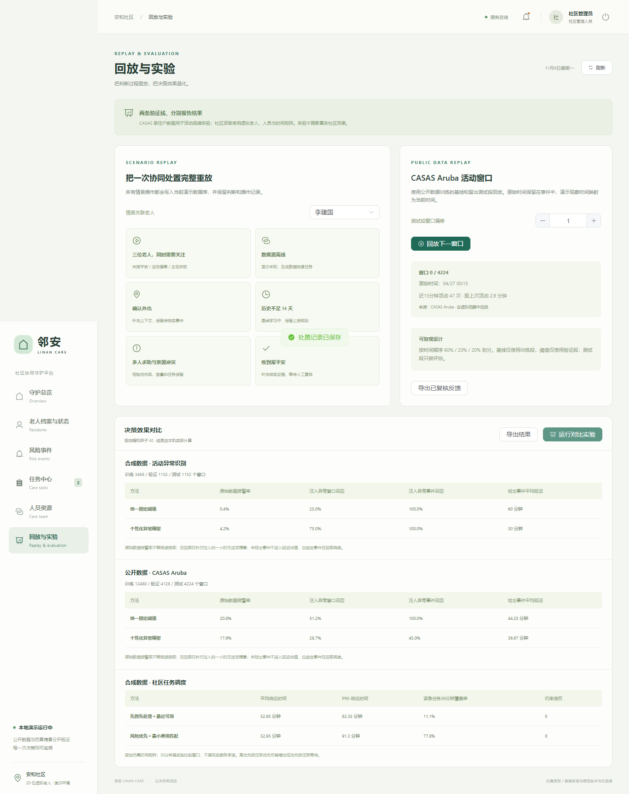

# 邻安 · LinAn

> 独居老人社区协同守护智能决策系统（比赛原型）  
> 从一条异常活动，到一次有人接住的上门核实——每个判断有依据，每个动作有留痕。


跑通 **状态上报 → 异常识别 → 风险分级 → 人员推荐 → 自动或人工确认派单 → 处置反馈 → 人工复核关闭** 的完整闭环，并在风险引擎与调度状态机之上提供四类业务 Agent、四角色对话助手和可追踪的工作流中心。

| 守护总览 | 任务中心 |
|---|---|
|  |  |

| 实验对照 | 手机端安心守护 |
|---|---|
|  |  |

## 形态

本仓库只保留一套本地运行、可调试的完整版本：[`linan/`](linan/README.md)。

| 组成 | 技术栈 |
|---|---|
| 后端 | FastAPI + SQLite + scikit-learn / SciPy |
| 客户端 | Flutter 3（Windows 桌面与 Android 共用 `linan/app/lib` 一套 Dart 代码） |
| 数据 | 20 位虚拟老人、4 位工作人员，合成基线 + CASAS Aruba 公开数据 |

不提供网页版，也不依赖云端服务；所有功能都在本机以 Windows 客户端或 Android 客户端连接本机 FastAPI 运行。

## 快速开始

准备：**Python 3.12+**、**Flutter 3.47+**（Windows 桌面构建还需要 Visual Studio 2022 的 C++ 桌面开发组件）。

```powershell
cd linan
powershell -ExecutionPolicy Bypass -File ./Setup.ps1
powershell -ExecutionPolicy Bypass -File ./Setup.ps1 -RebuildApp -FlutterExecutable "E:/tools/flutter/bin/flutter.bat"
powershell -ExecutionPolicy Bypass -File ./Start.ps1 -OpenApp
```

`Start.ps1` 启动本机 8765 端口的 FastAPI 服务，并打开 Windows 客户端；接口文档在 <http://127.0.0.1:8765/docs>。后台启动用 `-Background`，停止用 `./Stop.ps1`。

### 开发与调试

后端与客户端分开运行，改代码后热重载：

```powershell
# 终端 1：只启动后端（不自动打开客户端）
powershell -ExecutionPolicy Bypass -File ./Start.ps1 -Background

# 终端 2：Windows 调试，支持热重载
cd app
flutter run -d windows
```

Android 调试需要模拟器或真机：`flutter run -d <device-id>`，客户端默认连 `10.0.2.2:8765`，登录页可改为电脑的局域网地址。

## 演示账号

所有账号初始密码均为 **Demo2026!**，只对应虚拟档案。

| 账号 | 角色 | 权限范围 |
|---|---|---|
| `admin` | 社区管理员 | 全部演示档案、派单、复核、实验 |
| `staff1`—`staff4` | 照护人员 | 自己的任务、当前关联服务对象、自己的人员状态 |
| `family` | 家属 | 仅王桂兰的状态、上报与消息 |
| `elder` | 老人本人 | 仅王桂兰的报平安、求助与状态 |

## 核心设计

- **规则先行**：主动求助直接进入紧急人工处理；报平安、外出确认与模型文字都不能降低或关闭未关闭的紧急事件。
- **未知不是正常**：数据缺失单独显示"状态未知"；历史不足 14 天显示"基线学习中"，不生成虚构成熟基线。
- **模型只解释**：风险等级由规则与离线模型决定，大模型只解释证据、查询授权记录并生成建议；每次读取工具与会话历史都重验角色和对象权限。
- **派单可复核**：按紧急程度与等待时间优先覆盖任务，再最小化本批仿真到达时间；确认时校验版本、技能、值班、可用性与单人容量。
- **一切留痕**：风险输入快照、推荐理由、人工调整、操作人与时间、Agent 运行节点均可追溯；SQLite 写入使用 `BEGIN IMMEDIATE` 与部分唯一索引。

## 验证

```powershell
cd linan
powershell -ExecutionPolicy Bypass -File ./Verify.ps1 -FlutterExecutable "E:/tools/flutter/bin/flutter.bat"
```

依次执行后端 `pytest`、`flutter analyze`、`flutter test` 与 Windows Release 构建。2026-11-11 实测：后端 **56 passed**、`flutter analyze` 无问题、`flutter test` 1 passed、Windows 构建通过；管理员/照护/家属/老人四角色客户端闭环与权限边界均通过。详细记录、截图与已知限制见 [验证说明](linan/docs/VERIFICATION.md)，实验数据见 [实验报告](linan/docs/EXPERIMENT_REPORT.md)。

## 数据与已知局限

公开实验基于 CASAS Aruba，按完整日期顺序近似 60% / 20% / 20% 划分，基线只用训练段、森林阈值只用验证段。**个性化方法对注入异常的事件召回率为 45%，低于固定阈值的 100%，不能作为独立安全保障。** 原始报警率不等于误报率，当前为开发评估，不是盲测或真实社区效果。

社区、老人、联系人、工作人员与到达时间矩阵均为合成数据；演示密码与角色体系不能替代真实社区的账户管理和数据授权流程。本机环境未做 Android 真机安装与 iOS/macOS 构建，详见验证文档。

## 文档

- [完整版说明](linan/README.md)
- [用户手册与六分钟演示脚本](linan/docs/USER_MANUAL.md)
- [Agent、助手与工作流](linan/docs/AGENT_WORKFLOWS.md)
- [实验报告](linan/docs/EXPERIMENT_REPORT.md)
- [验证记录](linan/docs/VERIFICATION.md)

## 许可与署名

- 代码以 **Apache License 2.0** 发布，见 [LICENSE](LICENSE)；第三方组件声明见 [linan/THIRD_PARTY_NOTICES.txt](linan/THIRD_PARTY_NOTICES.txt)。
- 数据集：Cook, Diane; Crandall, Aaron; Thomas, Brian. *CASAS Smart Home dataset (aruba, cairo, milan, tulum)* (2025). Zenodo. [DOI:10.5281/zenodo.17180309](https://doi.org/10.5281/zenodo.17180309)，许可 [CC BY 4.0](https://creativecommons.org/licenses/by/4.0/)。本项目仅使用 Aruba，派生方式与校验值见 `linan/scripts/data_pipeline.py` 与 `linan/data/source_manifest.json`。
