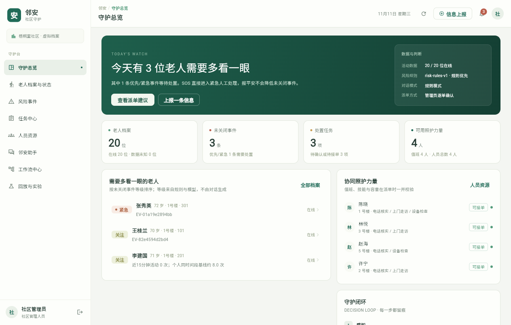

# 邻安 · 独居老人社区协同守护智能决策系统

完整闭环：**状态上报 → 异常识别 → 风险分级 → 人员推荐 → 自动或人工确认派单 → 处置反馈 → 人工复核关闭**。新增四类业务 Agent、四角色对话助手和可追踪的工作流中心；自动派单默认关闭，仅在管理员开启后用于1级关注的电话核实任务。

技术：Flutter 3（Web / Windows / Android 共用一套 Dart 代码，Material 3 自绘界面）+ FastAPI / SQLite + scikit-learn / SciPy。图表使用 Flutter 原生绘制，不依赖 Web 图表库。



## 立即体验

当前 Codex 工作目录已安装依赖，双击 **Start-Linan.cmd** 自动后台启动并打开网页。也可运行 `powershell -ExecutionPolicy Bypass -File .\Start.ps1 -Background -OpenBrowser`，访问 **http://127.0.0.1:8765**。重复启动会复用已运行的邻安服务。关闭启动窗口不会停止后台服务；电脑重启后重新双击启动即可。

在其他 Windows 电脑解压源码包后，需要 **Python 3.12+**。首次运行：

```powershell
powershell -ExecutionPolicy Bypass -File .\Setup.ps1
powershell -ExecutionPolicy Bypass -File .\Start.ps1
```

包内包含构建好的 Flutter Web 产物与处理后的公开数据；运行不需要 Flutter SDK、Node.js、外部 AI API 或再次下载数据。首次安装 Python 依赖需要联网。只有重建 Web 产物或自行构建 Windows / Android 客户端时才需要 Flutter 3.47+：`Setup.ps1 -RebuildFrontend`（可用 `-FlutterExecutable` 指定 SDK）。

局域网演示可运行 `Start.ps1 -HostAddress 0.0.0.0`，手机访问该电脑的局域网 IP 和 8765 端口，Windows 防火墙需允许访问。前台运行按 Ctrl+C 停止；后台运行使用 `powershell -ExecutionPolicy Bypass -File .\Stop.ps1` 停止。日志位于 `runtime/server.stdout.log` 和 `runtime/server.stderr.log`。

## 演示账号

所有账号初始密码均为 **Demo2026!**，只对应虚拟档案。

| 账号 | 角色 | 权限范围 |
|---|---|---|
| `admin` | 社区管理员 | 全部演示档案、派单、复核、实验 |
| `staff1`—`staff4` | 照护人员 | 自己的任务、当前关联服务对象、自己的人员状态 |
| `family` | 家属 | 仅王桂兰的状态、上报与消息 |
| `elder` | 老人本人 | 仅王桂兰的报平安、求助与状态 |

这是本地比赛原型。接入真实人员和资料前，应替换演示身份体系与密码，补齐部署级账户管理和数据授权流程。

## 走完一次闭环

1. 管理员进入“回放与实验”，选择“三位老人，同时需要关注”。也可演示数据离线、外出、冷启动或资源冲突。
2. 风险事件或老人详情显示信息来源、个人基线、判断依据与建议措施。
3. 在任务中心计算派单建议，查看技能、人员状态和仿真到达时间；调整人员必须填写原因。
4. 确认时重新检查任务与人员版本、技能、值班、可用性及占用；旧推荐失效时重新计算。
5. 切换对应 `staffN`，接单 → 开始处理 → 提交结果。拒单需说明原因，随后释放人员占用。
6. 管理员复核：已确认安全或数据问题已核查可以关闭；未能联系、仍需帮助必须继续跟进。
7. 在详情查看风险输入快照、推荐理由、人工调整、操作人和时间。

任务状态：待确认 → 已派单 → 已接单 → 处理中 → 待复核 → 已关闭。管理员也可提交直接核实结果后关闭尚未执行的任务。家属一次报平安不会自动关闭紧急事件。

## 数据、算法与实际局限

四角色可进入“邻安助手”查询自己有权查看的状态、风险与待办，回答附业务记录依据。管理员的“工作流中心”展示节点、模式和等待原因。未配置大模型时使用规则模式；可选配置、开发 Agent 与技能、统一验证及演示步骤见 [Agent 与工作流说明](docs/AGENT_WORKFLOWS.md)。

- 默认社区含 20 位虚拟老人、4 位工作人员；合成基线与 CASAS 单住户基线分开标注。
- 每十五分钟生成因果特征：活动次数、60分钟滚动次数、距上次活动时长、时段。个人时段基线与 Isolation Forest 联合判断。
- 历史不足十四天时显示基线学习中，保留人工上报与报平安规则；缺失数据单独显示未知。
- 新档案累计至少十四个日期、672个历史活动窗口后，从自己的历史建立模型；训练排除当前待判断窗口。模型尚未准备好时继续显示学习中。
- 主动求助直接进入紧急人工处理。关注事件的核实请求超过十分钟未获回应时按演示规则升级优先。
- 调度按紧急程度、等待时间优先覆盖任务，再最小化本批总仿真到达时间；技能、值班、可用性和单任务容量均为硬约束。
- 已复核反馈可导出并进入离线复盘；不把最终安全直接当作原始窗口的正常标签。候选模型离线训练，不自动覆盖在线模型。

公开实验基于 CASAS Aruba，按完整日期顺序近似 60% / 20% / 20% 划分。基线只使用训练段，森林阈值只使用验证段。

**当前公开数据结果存在明显局限：个性化方法对注入异常的事件召回率为45%，低于固定阈值的100%，不能作为独立安全保障。** 原始报警率不等于误报率；开发中已查看测试段初测结果，当前为开发评估，不是盲测或真实社区效果。调度对紧急任务有收益，也可能增加低优先级任务等待。

## 可复现命令

在项目根目录完成 Setup 后执行：

```powershell
powershell -ExecutionPolicy Bypass -File .\Verify.ps1
# 可选：验证通过后打包干净源码
powershell -ExecutionPolicy Bypass -File .\Verify.ps1 -Package
.\.venv\Scripts\python.exe scripts\experiments.py
# 重新从官方归档下载并处理Aruba（下载约33 MB）
.\.venv\Scripts\python.exe scripts\data_pipeline.py
# 或使用已获得的原始文件
.\.venv\Scripts\python.exe scripts\data_pipeline.py --input data\raw\aruba.txt
# 离线候选模型与已关闭反馈复盘材料，不替换在线模型
.\.venv\Scripts\python.exe scripts\train_model.py
# 打包干净源码
.\.venv\Scripts\python.exe scripts\package.py
```

前端验收由 `Verify.ps1` 依次执行 `flutter analyze`、`flutter test` 与 `flutter build web --release`；`-BackendOnly` / `-FrontendOnly` 可只跑一侧，`-Package` 追加干净源码包。验收使用独立日志目录 `runtime/verify/`，不覆盖旧记录。四角色验收步骤、截图与已知限制见 `docs/VERIFICATION.md` 与 `docs/*.png`。

源码包输出至 `artifacts/linan-source.zip`，文件与 SHA256 清单为 `artifacts/linan-source.manifest.json`。

## 文件与接口

| 位置 | 内容 |
|---|---|
| `backend/` | 认证、SQLite、风险引擎、模型、调度与实验 |
| `app/` | Flutter 单代码库：`app/lib/src/` 为页面与状态层，`app/build/web/` 为可直接运行的 Web 构建，`app/build/windows/`、`app/build/app/outputs/flutter-apk/` 为原生构建产物 |
| `scripts/`、`tests/` | 数据流水线、实验、离线训练、打包和后端测试 |
| `data/` | 标准化窗口、来源清单、实际实验结果 |
| `docs/` | 用户手册、实验报告、录屏、截图与验证结果 |
| `runtime/` | 首次启动生成的持久化数据库与离线候选模型 |
| `.codex/agents/`、`.agents/skills/` | 项目角色 Agent 与开发、验收、演示技能 |

交互式接口文档：**http://localhost:8765/docs**。接口使用 Bearer 令牌和服务端角色、对象范围验证，包括 `/api/events`、`/api/elders`、`/api/incidents`、`/api/tasks`、`/api/dispatch/recommend`、`/api/dispatch/confirm`、`/api/replay/window`。

SQLite 写入使用 `BEGIN IMMEDIATE`，部分唯一索引保证一人只占用一项执行任务。事件ID去重；历史事件保留但不覆盖更新的当前状态；重启后继续扫描超时。停止服务后备份 `runtime/` 可保留演示状态。源码压缩包不包含会话、数据库、依赖目录或原始归档。

## 交付文档

- [用户手册与演示脚本](docs/USER_MANUAL.md)
- [Agent、助手、开发工作流与新演示顺序](docs/AGENT_WORKFLOWS.md)
- [实际实验报告](docs/EXPERIMENT_REPORT.md)
- [迁移前 Vue 版操作录屏](docs/demo.webm)（仅作流程参考，界面以截图为准）
- [验证说明与四角色验收记录](docs/VERIFICATION.md)

Python 验证版本由 `requirements.lock.txt` 固定，Flutter 版本由 `app/pubspec.lock` 固定。

## 数据署名

Cook, Diane; Crandall, Aaron; Thomas, Brian. *CASAS Smart Home dataset (aruba, cairo, milan, tulum) — free living, motion, door, temperature, activity labels* (2025). Zenodo. [DOI:10.5281/zenodo.17180309](https://doi.org/10.5281/zenodo.17180309)，许可：[CC BY 4.0](https://creativecommons.org/licenses/by/4.0/)。

本项目只使用 Aruba；`aruba_windows.csv` 为原始运动传感器ON事件转换所得，方法、时间处理与校验值见脚本和 `data/source_manifest.json`。人物、联系人、工作人员与到达时间矩阵均为合成数据。
